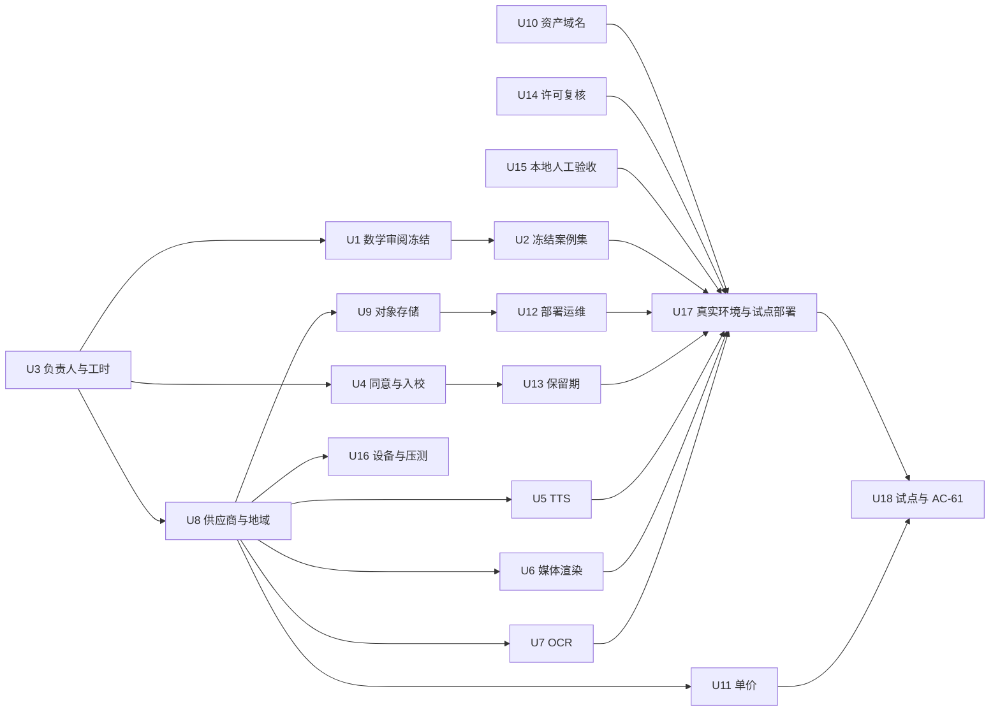

# 12 外部事项操作指南（U1 至 U18）

本指南把 [11 号文件第 9 节](11-运维交接与已知缺口.md#9-用户须提供或决定的事项ci-校验) 的 18 个外部事项逐项展开成可在本地执行的操作。每项给出：解锁的 DEV 与 AC、谁来做、需要准备的输入、具体操作、验证命令与期望输出、证据记录方式、交回开发侧的内容，以及开发侧尚未实现、目前无法由你在本地完成的部分。

写作依据：2026-10-31（UTC+9）在 main 分支（提交 fd5fd9bc 之后）的代码与一次全新目录下的本地联调（SQLite、宿主机三进程）。凡写“已验证”的步骤都在那次联调中实际执行过；凡写“未实现”的内容，不要尝试在本地绕过，交回开发侧。

## 目录

* [0 使用规则](#0-使用规则)
* [1 前置准备](#1-前置准备)
* [2 数学和教研：U1 U2 U3](#2-数学和教研u1-u2-u3)
* [3 凭据和服务：U5 至 U11](#3-凭据和服务u5-至-u11)
* [4 合规：U4 U14 U13](#4-合规u4-u14-u13)
* [5 部署和运维：U12 U16](#5-部署和运维u12-u16)
* [6 验收和试点：U15 U17 U18](#6-验收和试点u15-u17-u18)
* [7 待确认问题决定清单](#7-待确认问题决定清单)
* [8 开发侧未实现与阻塞清单](#8-开发侧未实现与阻塞清单)
* [9 安全提醒](#9-安全提醒)
* [附录 模板](#附录-模板)

## 0 使用规则

1. **证据编号**：你在本地或机构完成的每一条外部记录编号为 `U<两位编号>-R<两位序号>`，例如 `U15-R01`。开发侧接入时再分配 04 中的 E 编号（当前最大 E89）并在 04、05、11 中引用你的记录编号。
2. **记录存放**：模板在 [templates/](templates/README.md)。本仓库是公开仓库，只有不含个人信息、不含密钥、不含内网主机名的记录才能提交到 `docs/math-workbench/records/`；签字原件、同意书、合同、采购记录留在机构受控存储，记录里只写编号与存放位置描述。
3. **状态口径**：人工审阅不冒充自动验证；本地演练不冒充真实部署；没有真实试点证据就不填写 AC-61。未执行的项写“未执行”。
4. **交回方式**：在仓库提 issue 或直接告知开发侧，标题写 `U<编号> 交回`，正文列出“交回内容”一栏要求的项和记录编号。密钥不放在 issue、文档、聊天里，只说明已放入哪个密钥管理条目。
5. **时间**：记录中的时间写明时区，例如 `2026-11-02 10:30（UTC+9）`。

## 1 前置准备

### 1.1 拉取代码

```bash
git clone https://github.com/newyngwieslash-ops/WeaveSense-Math.git
cd WeaveSense-Math
git pull            # 以后每次操作前先拉取
git log -1 --format='%H %cd'   # 记下提交，写入每份记录的“版本”栏
```

根目录 README 里的克隆地址指向上游项目，请使用上面的地址。

### 1.2 本地依赖

| 依赖 | 版本 | 用途 |
| --- | --- | --- |
| Go | 1.25 | 后端 |
| Bun | 1.3 | 前端 |
| Python | 3.12 | 数学服务（依赖 sympy 1.13.3、mpmath 1.3.0） |
| openssl | 任意 | 生成数学服务密钥 |
| Docker | 可选 | Docker 方式运行、本地 SMTP 收信、Postgres |
| PostgreSQL | 可选，17 | 验证 RLS 与恢复演练（U12）；默认 SQLite 即可完成 U13、U15 |
| Chrome | 可选 | 自动浏览器测试 `bun run test:edu:e2e` |

### 1.3 本地启动（宿主机三终端，已验证）

教育功能只有在后端配置了数学服务地址时才注册 `/api/edu` 路由（未设 FLOW_MATH_SERVICE_URL 时教育接口返回 404，属正常）。

**准备一次密钥（不提交）**

```bash
mkdir -p .local/project-workbench-debug .local/cache/go-build .local/cache/go-mod .local/math-data
openssl rand -hex 32 > .local/math.key   # 64 个十六进制字符；少于 32 字节时数学服务拒绝启动
chmod 600 .local/math.key
```

`.local/` 已被 .gitignore 忽略；不要把密钥文件复制到其他目录。

**终端一：数学服务**

```bash
cd services/math-service
python3.12 -m venv .venv && . .venv/bin/activate
pip install -r requirements.txt
MATH_SERVICE_KEY="$(cat ../../.local/math.key)" \
MATH_DATA_DIR=../../.local/math-data \
MATH_LISTEN=127.0.0.1:8790 \
MATH_EVENT_URL=http://127.0.0.1:8080/api/edu-math-events \
python -m mathsvc.server
```

验证：`curl -s http://127.0.0.1:8790/healthz`，期望
`{"ok": true, "version": "math-service/0.1.0", "catalog_version": "edu-math-catalog/2026.10.0"}`（版本号随发布变化）。
MATH_EVENT_URL 可省略，省略时后端靠轮询获取作业结果。端口 8790 被占用时（启动报 Address already in use），同时改 MATH_LISTEN 与下面后端的 FLOW_MATH_SERVICE_URL。

**终端二：后端**

```bash
cd backend
CANVAS_BACKEND_ADDR=127.0.0.1:8080 \
CANVAS_BACKEND_DATA_DIR=../.local/project-workbench-debug \
GOCACHE=../.local/cache/go-build \
GOMODCACHE=../.local/cache/go-mod \
FLOW_MATH_SERVICE_URL=http://127.0.0.1:8790 \
FLOW_MATH_SERVICE_KEY="$(cat ../.local/math.key)" \
EDU_MATH_REQUIRE_SERVICE=1 \
go run ./cmd/server
```

验证：`curl -s http://127.0.0.1:8080/api/health/ready`，期望 ready 为 true，schema 的 current 与 expected 相等（当前均为 98）。`curl -s http://127.0.0.1:8080/api/system/version` 返回版本与 schema。

默认数据库是 SQLite（数据在 CANVAS_BACKEND_DATA_DIR）。要用 Postgres，另设 `CANVAS_DATABASE_DRIVER=postgres` 与 `DATABASE_URL=postgres://<应用角色>:<口令>@127.0.0.1:5432/<库名>?sslmode=disable`，应用角色的建法见 U12 第 4 步。

**终端三：前端**

```bash
cd web
bun install --frozen-lockfile
bun run dev
```

打开 http://localhost:3000 。前端把 `/api` 代理到 127.0.0.1:8080（可用 VITE_API_PROXY_TARGET 改）。Windows 可用 `.\scripts\start-local.ps1` 启动平台部分，但教育相关的环境变量需按上面自行加上。

**后端环境变量速查（教育相关，均为可选，除非注明）**

| 变量 | 默认 | 作用 |
| --- | --- | --- |
| FLOW_MATH_SERVICE_URL | 空 | 数学服务地址；空则不注册教育接口 |
| FLOW_MATH_SERVICE_KEY | 空 | 与 MATH_SERVICE_KEY 相同 |
| EDU_MATH_REQUIRE_SERVICE | 关 | 设为 1 时数学服务不可用即失败关闭 |
| FLOW_PRICE_BOOK | 内置 price_v1 | 价目表 JSON，见 U11 |
| EDU_MATH_JOB_BUDGET_MICRO | 120000 | 单作业默认预算（问题 1） |
| EDU_PAUSE_GENERATION | 关 | 设为 1、true 或 on 时暂停全部生成 |
| EDU_RETENTION_EVERY | 24h | 保留期清理周期，最小 1h，off 关闭 |
| EDU_LEDGER_RECONCILE_EVERY | 24h | 账本对账周期，最小 5m，off 关闭 |
| EDU_METRICS_EVERY | 1h | 指标收集周期，最小 5m，off 关闭 |
| EDU_RESTORE_JOURNAL | 空 | 恢复日志文件路径，见 U12 |
| EDU_BUDGET_TZ | Asia/Shanghai | 预算月份计算时区 |
| EDU_ARTIFACT_URL_KEY | 由数学服务密钥派生 | 签名取件链接密钥，至少 32 字节；生产单独生成（`openssl rand -hex 32`）并放入密钥管理 |
| EDU_APP_VERSION | 空 | 写入审计与报告的应用版本 |
| CANVAS_REGISTRATION_ENABLED | 关 | 开放注册（见 1.4） |

### 1.4 账号与角色（已验证）

**第一个账号**：浏览器打开 http://localhost:3000 注册，第一个注册的用户自动成为平台管理员。也可用接口：

```bash
B=http://127.0.0.1:8080
curl -s -c .local/admin.jar -H 'Content-Type: application/json' \
  -d '{"username":"admin1","password":"<本地测试口令>","acceptedTerms":true}' $B/api/auth/register
# 以后登录：
curl -s -c .local/admin.jar -H 'Content-Type: application/json' \
  -d '{"username":"admin1","password":"<本地测试口令>"}' $B/api/auth/login
```

**给自己绑定教育角色**：平台管理员可以绑定角色，但本身不获得教育角色。个人机构的租户编号是 `tn_u_<用户编号>`。

```bash
curl -s -b .local/admin.jar $B/api/edu/me          # 读 userId
U=<userId>
for r in org_admin teacher; do
  curl -s -b .local/admin.jar -H 'Content-Type: application/json' \
    -d "{\"tenantId\":\"tn_u_$U\",\"userId\":\"$U\",\"role\":\"$r\",\"reason\":\"local setup\"}" $B/api/edu/roles
done
```

可绑定的教职角色：teacher、reviewer、org_admin。学生不通过角色绑定，只能通过班级邀请码或名单认领加入。

**第二个账号（学生视角）需要本地收信**：平台默认要求邮箱验证码注册，只开放注册还不够。按顺序：

1. 开放注册：`curl -s -b .local/admin.jar -X PATCH -H 'Content-Type: application/json' -d '{"enabled":true}' $B/api/admin/settings/registration`（或启动时设 CANVAS_REGISTRATION_ENABLED=true）。
2. 起一个本地 SMTP 收信器，二选一：
   * `docker run --rm -p 1025:1025 -p 8025:8025 axllent/mailpit`，在 http://localhost:8025 看信；
   * `pip install aiosmtpd && PYTHONUNBUFFERED=1 python -m aiosmtpd -n -l 127.0.0.1:1025`，验证码打印在终端。
3. 配置平台邮件（本地专用，生产按 U8 选型配置真实 SMTP，凭据进密钥管理）：

   ```bash
   curl -s -b .local/admin.jar -X PATCH -H 'Content-Type: application/json' \
     -d '{"enabled":true,"host":"127.0.0.1","port":1025,"encryption":"none","fromEmail":"noreply@example.com","registrationAllowedDomains":["example.com"]}' \
     $B/api/admin/settings/email
   ```

4. 申请验证码（约 60 秒限流一次）：`curl -s -H 'Content-Type: application/json' -d '{"email":"student1@example.com","purpose":"register"}' $B/api/auth/email-code`
5. 用收到的验证码注册：在浏览器注册页填写，或接口：

   ```bash
   curl -s -c .local/student.jar -H 'Content-Type: application/json' \
     -d '{"username":"student1","password":"<本地测试口令>","acceptedTerms":true,"email":"student1@example.com","emailCode":"<验证码>"}' \
     $B/api/auth/register
   ```

只用 example.com 这类保留域名的虚构邮箱，不要用真实学生信息。

**学生加入班级（已验证）**：教师在 /edu/teach 建班并生成邀请码（接口 `POST /api/edu/classes {"name":"…"}`，`POST /api/edu/classes/<班级编号>/invites {"ttlHours":72,"maxUses":40}`）；学生登录后在 /edu/learn 输入邀请码（接口 `POST /api/edu-join {"code":"…"}`，返回 consentRequired 为 true）。机构策略为需要监护人同意时，管理员在 /edu/teach 名单的“同意凭证编号”录入编号后，学生才能看到任务（见 U4）。

学生端接口必须带请求头 `X-Edu-Tenant: tn_u_<教师或机构的用户编号>`，前端会自动带上；你用 curl 调学生接口时不带此头会得到 403，这不是同意流程的问题。

**页面入口**：/edu/home（首页与示例）、/edu/author（备课与审核）、/edu/teach（班级与任务）、/edu/learn（学生）、/edu/admin（机构管理：预算、保留期、策略、运维授权等）。没有单独的运维页面，运维只读接口见 U12。

### 1.5 Docker 方式与镜像

| 方式 | 命令 | 教育功能 |
| --- | --- | --- |
| 开发 | `LOCAL_UID=$(id -u) LOCAL_GID=$(id -g) docker compose -f docker-compose.dev.yml up --build` | 关闭 |
| 本地发布 | `docker compose -f docker-compose.local.yml up -d --build` | 关闭 |
| 部署 | `docker-compose.deploy.yml`，配合 GHCR 镜像 | 关闭 |

端口可用 CANVAS_WEB_HOST_PORT、CANVAS_BACKEND_HOST_PORT 覆盖。

**重要缺口**：目前没有数学服务镜像，任何 compose 文件也没有传入 FLOW_MATH_*、EDU_*、FLOW_PRICE_BOOK，所以 Docker 方式下教育功能是关闭的。U13、U15 请用 1.3 的宿主机方式；U17 的真实部署需要开发侧先补数学服务镜像与 compose 接线（见第 8 节）。

**GHCR 镜像（公开）**：

* `ghcr.io/newyngwieslash-ops/weavesense-math-backend`
* `ghcr.io/newyngwieslash-ops/weavesense-math-web`
* `ghcr.io/newyngwieslash-ops/weavesense-math-yingce-agent`

标签有 `sha-<完整提交>`、`sha-<前 7 位>`、`latest` 与版本号。部署时：

```bash
docker buildx imagetools inspect ghcr.io/newyngwieslash-ops/weavesense-math-backend:sha-<提交前7位>   # 读 Digest
export CANVAS_IMAGE_TAG=sha-<提交前7位>
export CANVAS_BACKEND_IMAGE=ghcr.io/newyngwieslash-ops/weavesense-math-backend@sha256:<digest>
export CANVAS_WEB_IMAGE=ghcr.io/newyngwieslash-ops/weavesense-math-web@sha256:<digest>
export CANVAS_YINGCE_AGENT_IMAGE=ghcr.io/newyngwieslash-ops/weavesense-math-yingce-agent@sha256:<digest>
```

CANVAS_BACKEND_IMAGE、CANVAS_WEB_IMAGE 必须带 digest；CANVAS_YINGCE_AGENT_IMAGE 不设时默认指向上游镜像，务必显式设置。不要启用 host-updater。详见 [07](07-部署-迁移-回退-恢复.md)。

### 1.6 自动测试基线（每次拉取后可跑）

```bash
# 数学服务
cd services/math-service && . .venv/bin/activate
python -m unittest tests.test_math tests.test_jobs tests.test_server tests.test_families tests.test_regression \
  tests.test_grade tests.test_intake tests.test_events tests.test_hostile tests.test_notice tests.test_cues tests.test_admission
# 后端教育模块：端到端用例会启动真实数学服务，MATH_PYTHON 指向装好 sympy 的解释器，否则这些用例被跳过
cd ../../backend && MATH_PYTHON="$PWD/../services/math-service/.venv/bin/python" go test ./internal/edumath/...
# 名称带 PG 的用例需要 Postgres：另设 FLOW_TEST_PG_RLS_DSN（应用角色须为 NOSUPERUSER NOBYPASSRLS，见 U12 第 4 步），未设时跳过
# 交接一致性检查
cd .. && PYTHONDONTWRITEBYTECODE=1 python3 .github/scripts/check-edu-handover.py .
```

交接检查期望输出 `problems=0`。

### 1.7 推荐顺序与依赖



建议节奏：

1. 第一周：U3（定人）；同时开始 U1、U4、U8、U14，并可立即做 U15 与 U13（本地即可）。
2. U1 签字后开始 U2；U8 选型后并行 U5、U6、U7、U9、U10、U11、U16。
3. U12 在类生产环境完成并通过演练后，进入 U17。
4. U17 在真实环境执行 AC-01 至 AC-60 后，才进入 U18 试点；AC-61 只能来自 U18 的真实试点数据。

真实学生只在 U4 放行条件全部满足、U13 已确认之后使用（硬约束 8）。

## 2 数学和教研：U1 U2 U3

### U1 数学负责人逐族审阅、签字，冻结准入集

| 项 | 内容 |
| --- | --- |
| 解锁 | DEV-009 DEV-032 DEV-033 DEV-034 DEV-035 DEV-036 DEV-037 DEV-043；G2（六题族逐族准入） |
| 谁做 | 数学负责人（审阅签字）；FR-Q01 准入集由独立教师编写 |
| 输入 | 本仓库当前提交；[06 数学目录](06-数学目录-限制-许可.md) 中六族的闭式结论与参数范围；工程回归报告 `services/math-service/tests/admission_report.json`；审阅导出表（下面第 2 步生成） |

**现状**：六族（SOLID-VOL-01、SOLID-ANGLE-01、SOLID-ANGLE-02、CONIC-CHORD-01、CONIC-SLOPE-01、CONIC-PARABOLA-01）在目录里全部是 `admission: "dev"`；admission_report.json 的 kind 是 `engineering_admission_set_not_frozen`，每族合法用例 105 至 145 个、非法用例 22 至 24 个，独立数值核对容差为相对 1e-25，`math_lead_review` 均为 `pending_math_lead`。这是开发侧工程自测，不是准入。

**操作**

1. 准备数学服务环境（1.3 终端一的 venv 即可），确认工程回归通过：

   ```bash
   cd services/math-service && . .venv/bin/activate
   python -m unittest -v tests.test_admission
   ```

   期望最后一行 `OK`。该测试同时断言 admission_report.json 与重新生成的结果完全一致。

2. 导出审阅表（约 30 秒）：

   ```bash
   python -m tests.admission_review_export > ../../.local/admission_review.csv
   sha256sum ../../.local/admission_review.csv tests/admission_report.json
   ```

   列：family_id、case_no、kind（legal 或 `illegal:<拒绝类别>`）、input_json（参数）、service_exact_answer（服务给出的精确答案，JSON）、math_state、independent_numeric_agree（独立高精度数值核对是否一致）、expected_refusal、actual_refusal。当前约 840 行，其中合法用例约 700 行。用表格软件打开时选 UTF-8。

3. 逐族审阅，填 [templates/U1-数学审阅签字单.md](templates/U1-数学审阅签字单.md)：
   * 对照 06 的闭式结论，核对公式与教材约定（例如角的取值范围、根式化简形式）。
   * 每族至少抽查若干 legal 行，手算或用独立工具核对 service_exact_answer。
   * 检查 illegal 行的拒绝类别是否合理（例如退化图形、越界参数）。
   * 写出每个参数冻结后的允许集合或区间与单位。
   * 核对容量上限（`mathsvc/catalog.py` 的 LIMITS，当前值已列在签字单中），写出冻结值。
4. 安排独立教师编写 FR-Q01 准入集，格式按 [templates/U2-冻结案例集格式.md](templates/U2-冻结案例集格式.md)（category 写 supported，每族至少 25 例），算出 sha256。
5. 签字。签字单可以提交到 `docs/math-workbench/records/U01-R01.md`（不含个人联系方式时）；准入集文件不放进公开仓库的盲测部分。

**验证**

* 第 1 步 `OK`；第 2 步导出的行数与 admission_report.json 中各族 legal 与 illegal 计数之和一致。
* 签字单中“审阅材料版本”四个值齐全，且仓库提交与你审阅时 `git rev-parse HEAD` 一致。

**证据**：`U01-R<序号>`（签字单）；准入集 sha256 写在签字单里。

**交回开发侧**：签字单、各族冻结参数范围与容量上限、准入集文件（或其存放位置）与 sha256、问题清单。

**开发侧随后**（你不需要做）：把签字与冻结版本写入 05 与 06；按冻结范围收紧参数校验（当前参数校验只按 LIMITS，尚未按族冻结范围收紧）；目录中 admission 从 dev 改为准入；导入准入集并跑逐族准入。准入集导入工具尚未实现（与 U2 的 DEV-113 至 115 相同）。

### U2 金标准与 240 例冻结集

| 项 | 内容 |
| --- | --- |
| 解锁 | DEV-010 DEV-113 DEV-114 DEV-115；G2 |
| 谁做 | 教研负责人（金标准与复核计划）；独立教师（编写冻结集，开发侧不得编写）；争议复核人员 |
| 输入 | U1 冻结的参数范围；金标准文档；格式约定 [templates/U2-冻结案例集格式.md](templates/U2-冻结案例集格式.md) |

**操作**

1. 教研负责人写金标准与独立复核计划：每类案例“正确”的判定口径、数学阻断的定义（数学阻断不得被其他维度分数抵消）、两人复核与争议裁决流程、复核人员名单。
2. 独立教师按格式编写 240 例：supported 150（每族不少于 25）、image 30、illegal 30、teaching 30。
3. 划分 split：dev（可交开发侧回归）与 blind（盲测）。同一 source_group 只能出现在一个 split。
4. blind 部分的答案单独成文件，只交评测执行人保管，不进入仓库、Skill、检索或调试日志。
5. 计算 sha256，按格式末尾的“交付自检”逐条核对。

**验证（本地自检）**

```bash
python3 - <<'PY'
import csv, collections
rows = list(csv.DictReader(open("frozen_set_v1.csv", encoding="utf-8")))
print("total", len(rows))
print(collections.Counter(r["category"] for r in rows))
print(collections.Counter(r["family_id"] for r in rows if r["category"] == "supported"))
groups = collections.defaultdict(set)
for r in rows: groups[r["source_group"]].add(r["split"])
print("leaking groups", [g for g, s in groups.items() if len(s) > 1])
PY
```

期望：total 240；supported 150、image 30、illegal 30、teaching 30；每族至少 25；leaking groups 为空列表。

**证据**：`U02-R<序号>`（金标准文档编号、冻结集 sha256、复核人员名单的存放位置）。

**交回开发侧**：dev 部分文件与 sha256；blind 部分只交 sha256 与保管人；金标准与复核计划。

**未实现（阻塞）**：冻结集导入、盲测隔离（开发侧不可见答案的执行环境）、逐族准入与分层报告的工具都还没有（DEV-113 至 115）。你交付后由开发侧实现，届时由评测执行人运行盲测。

### U3 团队负责人与工时

| 项 | 内容 |
| --- | --- |
| 解锁 | DEV-012（02 的交付估算） |
| 谁做 | 你或 PM |
| 输入 | 各事项的负责人、备份负责人、可用工时 |

**操作**：填 [templates/U3-负责人与工时表.md](templates/U3-负责人与工时表.md) 的 A 表（外部事项负责人与时间）；B 表由开发侧填写。依赖列已按 1.7 预填。

**验证**：A 表每行都有负责人与计划完成日期；依赖项的计划完成早于被依赖项的计划开始。

**证据**：`U03-R01`。

**交回开发侧**：填好的表。开发侧据此补全 [02](02-任务依赖与实施计划.md) 中 W 阶段与 G1 至 G3 门禁的负责人与估算。

## 3 凭据和服务：U5 至 U11

本组共同规则：
* 所有凭据（API 密钥、存储访问密钥、证书私钥）只放在部署环境变量或密钥管理系统，不写入仓库、文档、issue、截图。交回开发侧时只说“已放入密钥管理条目 <名称>，由部署方注入”。
* 平台对付费调用的规则：作业受理时冻结价目，阶段完成才结算，未知结果不盲目重试付费调用（硬约束 5、6）。新供应商接入前，供应商的错误码与重试语义必须由 U8 提供。
* 当前代码中**没有** TTS、媒体渲染、教育题图 OCR、对象存储（教育模块）的供应商适配器。本组 U5 至 U10 你能完成的是选型、采购、凭据准备与决定记录；接入是开发侧的工作。U11 是唯一可以由你在本地直接生效并验证的一项。

### U8 供应商方案与地域（本组先做）

| 项 | 内容 |
| --- | --- |
| 解锁 | DEV-011 DEV-058 DEV-105；是 U5 U6 U7 U9 U11 U16 的前提 |
| 谁做 | 你与部署方 |
| 输入 | 候选供应商的服务条款、数据处理条款、可用地域、价格、配额、错误码文档 |

**操作**

1. 为对象存储、TTS、模型（OCR 与平台模型）、媒体渲染各选定一家（或决定自建），记录：供应商、服务、地域、计费单位与单价、配额（并发与每分钟请求）、数据是否用于训练、数据保存期限。
2. 决定数据地域（与 U4 的 DG 意见一致）与出站白名单：列出生产环境允许访问的外部域名与端口。
3. 对每家供应商整理错误码与重试语义表，至少四列：错误码或 HTTP 状态、含义、是否可重试、调用结果是否确定（例如超时后对方是否可能已计费）。结果不确定的错误开发侧会映射为需对账，不自动重试。
4. 填写决定记录（建议用 `docs/math-workbench/records/U08-R01.md`，不含密钥与账号信息）。

**验证**：每家供应商四项（地域、价格、配额、错误码表）齐全；出站白名单中的域名都能对应到一家选定供应商。

**证据**：`U08-R<序号>`。

**交回开发侧**：选型与地域表、出站白名单、错误码与重试语义表。

**未实现**：供应商错误映射与重试规则（DEV-058）、出站约束配置（DEV-105）由开发侧在收到上表后实现。

### U5 TTS 供应商与音色授权

| 项 | 内容 |
| --- | --- |
| 解锁 | DEV-022 DEV-042 DEV-088 DEV-097 DEV-098 DEV-099 DEV-101 |
| 谁做 | 你（选型与采购） |
| 输入 | U8 的选型；音色授权合同；术语读法表 |

**操作**

1. 按 U8 选定 TTS 供应商，开通账号，创建专用于本项目的 API 凭据，放入密钥管理。不要把凭据发给开发侧，部署时由部署方注入环境变量（变量名由开发侧接入时确定）。
2. 取得音色授权：确认所用音色允许用于教育产品的商用分发，允许生成内容随讲解导出（AC-51）；记录授权范围与期限。授权文件交 U14 一并复核。
3. 准备术语读法表（UTF-8 CSV，开发侧接入时导入）：

   ```csv
   term,reading,context,note
   √,根号,数学式,
   ∠,角,几何,
   sin,正弦,三角函数,
   P-ABCD,P A B C D,立体几何,字母逐个读
   ```

4. 记录服务地域（与 U8 一致）与每单位价格（交给 U11）。

**验证**：在供应商控制台用测试文本（不含个人信息）合成一段，确认音色、读法、地域符合预期；确认术语读法表 CSV 能被 UTF-8 正常读取（`python3 -c "import csv;print(len(list(csv.DictReader(open('tts_glossary.csv',encoding='utf-8')))))"`）。

**证据**：`U05-R<序号>`（供应商、音色、授权编号与期限、地域、读法表 sha256）。

**交回开发侧**：供应商与接口文档链接、密钥管理条目名称、音色标识、读法表、地域、单价。

**未实现（阻塞）**：
* TTS 适配器与账本计量：没有。数学服务的 `math_media_render_start` 目前固定返回 `PROVIDER_UNAVAILABLE`。
* 价目表没有 TTS 用量类型：在 FLOW_PRICE_BOOK 里加 tts 一类的键会被判为无效，导致整份价目表回退到默认 price_v1（见 U11）。不要自行添加。
* 字幕与媒体的服务端投影和泄露验证、旁白词级时间对齐、有声讲解、音量与倍速、音频来源标识写入 ai_parts：都在接入后由开发侧完成。

### U6 媒体渲染

| 项 | 内容 |
| --- | --- |
| 解锁 | DEV-049 DEV-100 |
| 谁做 | 你（选型与采购） |
| 输入 | 视频渲染供应商，或自建渲染环境（机器规格、GPU 与否）及凭据 |

**操作**

1. 决定：外部渲染供应商，或自建渲染节点。自建时记录机器规格、操作系统、是否与平台主机隔离（硬约束 7：渲染必须隔离运行，不继承平台密钥）。
2. 记录输出规格需求：分辨率、帧率、最长时长、是否需要 MP4 导出。
3. 凭据放密钥管理；价格交 U11。

**验证**：供应商或自建节点能用一段无个人信息的测试素材出片；记录单次渲染时长，供 U16 容量估算。

**证据**：`U06-R<序号>`。

**交回开发侧**：选型、接口文档、密钥管理条目名称、输出规格、隔离方式。

**未实现（阻塞）**：`math_media_render_start` 与可选 MP4 导出未实现，当前只有静音结构化预览。

### U7 OCR 模型

| 项 | 内容 |
| --- | --- |
| 解锁 | DEV-069（并带动 DEV-106 中作答图保留期） |
| 谁做 | 你 |
| 输入 | 题图识别所用模型与凭据；平台已配置的模型是否允许用于教育租户 |

**操作**

1. 选定题图识别模型（U8），记录是否支持中文数学公式与几何图、地域、单价。
2. 决定平台管理后台中已配置的模型渠道能否用于教育租户（涉及学生与教师上传内容出站，与 U4 的 DG 意见一致）。
3. 凭据放密钥管理；单价交 U11（价目表键 `ocr_pages`，当前默认 2000 微积分每页）。

**验证**：用几张无个人信息的题图在供应商控制台试识别，记录公式与图形的识别质量，挑选进入 U2 image 类案例的样本。

**证据**：`U07-R<序号>`。

**交回开发侧**：模型选型、密钥管理条目名称、可否用于教育租户的书面决定。

**未实现（阻塞）**：教育模块的图片识别与题意确认（DEV-069）未实现；作答图功能也未启用，所以作答图保留期（imageDays）目前只是记录值。注意：仓库 services/loom-engine/workers/ocr 下有一个平台 Flow 用的 OCR 工作进程，它不是教育题图识别，不要把它当作 U7 已完成。

### U9 对象存储

| 项 | 内容 |
| --- | --- |
| 解锁 | DEV-059；并纳入 U12 的类生产恢复演练 |
| 谁做 | 部署方 |
| 输入 | U8 的选型与地域 |

**操作**

1. 建私有桶（禁止公开读），记录桶名、区域、加密方式、版本控制是否开启。
2. 生命周期规则与 U13 核定的保留期一致：临时对象按 tempDays，作答图按 imageDays；备份桶按 backupDays。
3. 建一个只允许访问该桶的最小权限凭据，放密钥管理。
4. 配置备份工具使用的 MinIO 客户端别名（只在运维机上，不提交）：`mc alias set <别名> <端点> <访问键> <密钥>`。
5. 演练对象备份（脚本在 `deploy/flow/backup/`）：

   ```bash
   deploy/flow/backup/objects-backup.sh <生产别名> /backups/objects <桶名>
   # 恢复演练只对另一个演练用实例执行（脚本按原桶名上传，指向生产会覆盖生产数据）：
   deploy/flow/backup/objects-restore.sh /backups/objects <演练别名>
   ```

   `objects-test.sh` 是针对测试用 MinIO 的自测脚本，会创建并强制删除临时桶，只能对测试实例运行（用法见脚本头部注释）。

**验证**：备份目录生成 `objects.manifest`；`objects-restore.sh` 先按 manifest 校验本地备份，上传后再下载比对校验和，脚本无报错退出（退出码 0）。结果填进 [templates/U12-恢复演练记录.md](templates/U12-恢复演练记录.md) 的 B 表。

**证据**：`U09-R<序号>`。

**交回开发侧**：桶名、区域、端点、密钥管理条目名称、生命周期规则。

**未实现（阻塞）**：教育模块尚未接入对象存储；题图目前存在数据库 `edu_problem_images.content`（单图不超过 10 MB，问题 20）。平台管理后台有一个对象存储设置（`/api/admin/settings/oss`），它服务于平台画布，不会让教育题图迁出数据库。

### U10 独立资产域名

| 项 | 内容 |
| --- | --- |
| 解锁 | DEV-060 |
| 谁做 | 部署方 |
| 输入 | 一个与主站不同源的域名（建议独立注册域名，至少独立子域名）与 TLS 证书 |

**操作**

1. 申请域名与证书，证书私钥只放在部署环境。
2. 规划反向代理：资产域名只转发签名取件路径，不承载登录 Cookie。
3. 记录域名、证书签发方与到期日。

**验证**：`curl -sI https://<资产域名>/` 返回有效证书（`curl -vI` 中 `SSL certificate verify ok`），且浏览器访问时没有主站 Cookie。

**证据**：`U10-R<序号>`。

**交回开发侧**：域名、反向代理规划、证书到期日。

**未实现（阻塞）**：资产仍由主站域名提供（已加 CSP sandbox）；改为独立域名由开发侧在收到域名后实现。

### U11 算力单价与默认预算

| 项 | 内容 |
| --- | --- |
| 解锁 | DEV-065；问题 1 |
| 谁做 | 你 |
| 输入 | U8 各供应商单价；math_compute_ms 单价（当前 1 微积分每毫秒为占位）；单作业默认预算（当前 120000 微积分）；机构月预算 |

**价目表格式**（环境变量 FLOW_PRICE_BOOK，JSON）：

```json
{"version":"price_2026_11_v1","unit_micro":{
  "llm_input_tokens":0,"llm_output_tokens":0,"ocr_pages":2000,"asr_seconds":100,
  "paid_source_calls":0,"mcp_calls":0,"stored_bytes":0,"notifications":0,
  "canvas_model_calls":0,"canvas_media_generations":0,"math_compute_ms":1}}
```

规则（已核对代码）：
* 只能使用上面 11 个键。出现未知键、负数或空 version 时，整份价目表**静默回退**到默认 price_v1。
* 漏写的键按 0 计价，所以每次都写全 11 个键。
* 每个作业受理时冻结价目版本；机构在新版本下受理第一个作业时写一条 `price_book.changed` 审计（操作者 system:price_book），出现在机构访问记录中。
* 改价必须换新的 version 字符串；版本号不变而单价变化会被标记 versionReused。

**操作**

1. 写出新价目 JSON（只改数值与 version），先在本地校验 JSON：`echo "$FLOW_PRICE_BOOK" | python3 -m json.tool`。
2. 在 1.3 终端二的后端启动命令前加：

   ```bash
   FLOW_PRICE_BOOK='{"version":"price_2026_11_v1","unit_micro":{…完整 11 个键…}}' \
   EDU_MATH_JOB_BUDGET_MICRO=<单作业默认预算> \
   ```

3. 设机构月预算：/edu/admin 预算一节；或接口 `GET /api/edu/budget` 后 `PUT /api/edu/budget`，体为 `{"monthlyMicro":…,"teacherMonthlyMicro":…,"maxActiveJobs":…,"maxActivePerTeacher":…,"maxRenderJobs":…,"alertPercent":…,"reason":"…"}`。
4. 生产环境由部署方把同一 JSON 写入部署配置（不是密钥，但需人工核对，见 U12）。

**验证（以下第 1、2 步已在本地验证）**

1. 重启后端后，在 /edu/author 新建一道题并确认题意、发起分析，或用接口：
   `POST /api/edu/problems`（体 `{"familyId":"SOLID-ANGLE-02","title":"价目验证","structured":{"family_id":"SOLID-ANGLE-02","input_state":"sufficient","unit":"","params":{"a":"2","h":"1"}}}`），
   `POST /api/edu/problem-revisions/<修订编号>/confirm {"inputHash":"<返回的 inputHash>"}`，
   `POST /api/edu/problem-revisions/<修订编号>/analyze {"idempotencyKey":"price-check-1"}`。
2. 返回的作业中 `priceVersion` 等于你的 version，`budgetMicro` 等于你设的默认预算。若 priceVersion 是 `price_v1`，说明价目表无效被回退，检查键名与数值。
3. `GET /api/edu/cost-report` 中 compute_succeeded 等行按新单价计价。若该机构此前已有旧价目版本下的作业，`GET /api/edu/org/access-log` 中出现 price_book.changed（全新机构的第一个作业没有旧版本可比，不写此审计）。
4. 自动测试：`cd backend && go test ./internal/edumath -run 'TestPriceChangeAudit|TestPriceChangeDiff|TestBudgetsAndFairness' && go test ./internal/flow -run TestUsageEventsPricedWithFrozenPriceVersionAndChargedOnce`，期望 `ok`。

**证据**：`U11-R<序号>`（价格表、version、生效日期、验证作业编号）。

**交回开发侧**：价目 JSON、默认预算、TTS、流量、存储单价（后三者目前无法写入价目表，见下）。

**未实现**：成本报告中 storage、tts、egress 三行目前 metered=false（未计量），因为价目表没有 TTS 与出站流量的用量类型，存储也未按教育资产计量。开发侧需新增用量类型后，你再把对应单价写进价目表。

## 4 合规：U4 U14 U13

### U4 监护人同意方式，DG 与学校审阅

| 项 | 内容 |
| --- | --- |
| 解锁 | DEV-017 DEV-111；真实学生使用的前置条件（硬约束 8） |
| 谁做 | 你、DG（数据保护负责人）、学校 |
| 输入 | [10 学校机构准入资料](10-学校机构准入资料.md)；机构的同意书模板；合同草案 |

**操作**

1. 把 10 号文件交 DG 与学校审阅，按 [templates/U4-监护人同意核对单.md](templates/U4-监护人同意核对单.md) 的 E 表逐章收意见。重点是 10 号文件第 6 节的六项：合同角色、监护人同意、数据地域、保留期、账号注销衔接、真实学生的前置条件。
2. 决定同意方式（05 问题 6），填核对单 A 表：
   * 方式一（已实现）：线下签字，机构管理员在平台录入证据编号。
   * 方式二（未实现）：监护人线上确认渠道，选择后交开发侧实现。
3. 决定机构策略并在本地验证效果：

   ```bash
   # 需要监护人同意（默认）
   curl -s -b .local/admin.jar -X PUT -H 'Content-Type: application/json' \
     -d '{"reviewMode":"self_allowed","consentMode":"guardian_required","editReviewInherit":"none","reason":"DG 意见 <编号>"}' \
     $B/api/edu/policy
   ```

   consentMode 只有 `guardian_required` 与 `not_applicable` 两个值；选 not_applicable 时 reason 至少 4 个字，写入审计。
4. 定证据编号规则（核对单 C 节，建议 `GC-<学年>-<班级代号>-<序号>`，4 至 300 字符，不含学生姓名或学号原值）。
5. 本地演练录入（方式一）：用 1.4 的测试学生加入测试班级，在 /edu/teach 名单中该学生行填“同意凭证编号”并保存；或接口 `POST /api/edu/consents {"studentUserId":"<学生用户编号>","status":"granted","evidenceRef":"GC-2026-T01-0001"}`。撤回用 `"status":"withdrawn"`。
6. 合同角色（受托处理方或其他）写入服务协议，记录在核对单 B 表。

**验证**

* 录入前：学生端 `GET /api/edu/student/assignments`（带 X-Edu-Tenant）返回 403，错误码 `CONSENT_REQUIRED`；录入后返回 200（班级没有任务时为空列表）。撤回后再次返回 CONSENT_REQUIRED。以上三步均已在本地验证。
* 自动测试：`cd backend && go test ./internal/edumath -run 'TestClassesInvitesConsentAuthorization|TestDataRequests'`，期望 `ok`。
* 核对单 F 节“放行条件”全部勾选。

**证据**：`U04-R<序号>`（核对单；DG 与学校意见编号；同意书原件只记存放位置）。

**交回开发侧**：同意方式决定、合同角色、10 号文件的修改意见、是否需要线上确认渠道。

**未实现**：监护人线上确认渠道（若选方式二）。删除请求是否联动平台账号注销（问题 19，默认不联动）也需要你在本项一起决定。

### U14 许可证正式复核

| 项 | 内容 |
| --- | --- |
| 解锁 | DEV-110 |
| 谁做 | 许可负责人 |
| 输入 | [06 数学目录、限制与许可](06-数学目录-限制-许可.md)“来源与许可”；`services/math-service/LICENSE-edulab` 与 `NOTICE`；各 Dockerfile；U5 音色授权；题库来源 |

**操作**

1. 按 [templates/U14-许可复核清单.md](templates/U14-许可复核清单.md) A 表逐项复核 06 的判定。
2. 列出基础镜像（当前未按 digest 固定）：

   ```bash
   grep -n '^FROM' Dockerfile backend/Dockerfile yingce-agent/Dockerfile
   ```

   当前为 oven/bun:1.3.9、nginx:1.27-alpine、golang:1.25-alpine、alpine:3.22、node:22.19-alpine。
3. 决定 OS 层 GPL 程序的源码获取方式（例如随发行提供上游源码地址与版本）。
4. 决定是否按 digest 固定基础镜像。若固定，用 `docker buildx imagetools inspect <镜像:标签>` 读出 digest，写进清单 B 节交开发侧；不要自行改 Dockerfile（06 中的基础层清单与 Dockerfile 由 CI 交接检查比对，必须一起改）。
5. 接入 TTS 或题库前，复核其条款（与 U5、U2 联动）。

**验证**：清单 A、B、C 三节无空项；D 节给出结论。

**证据**：`U14-R<序号>`。

**交回开发侧**：结论；digest 决定与各镜像 digest；源码获取方式的文字（开发侧写入 06 与 NOTICE）。

### U13 机构核定数据保留天数

| 项 | 内容 |
| --- | --- |
| 解锁 | DEV-106；问题 16 |
| 谁做 | 机构管理员（org_admin） |
| 输入 | U4 中 DG 对保留期的意见；[09](09-授权-投影-数据模型-契约冻结.md) 第 3.3 节建议值 |

本项无需改代码，确认后定时清理自动生效（EDU_RETENTION_EVERY，默认每 24 小时）。未确认前平台不删除任何数据。

**操作（本地已验证）**

1. 填 [templates/U13-保留期决定记录.md](templates/U13-保留期决定记录.md)。
2. 以 org_admin 打开 /edu/admin 保留期一节，填四个天数（临时 1 至 30、作答图 7 至 365、学习记录 30 至 1095、备份 1 至 30）与“保留期确认理由”（4 至 200 字，不含尖括号与换行），点“确认保留期”。或接口：

   ```bash
   curl -s -b .local/admin.jar -X PUT -H 'Content-Type: application/json' \
     -d '{"tempDays":7,"imageDays":90,"learningDays":180,"backupDays":30,"reason":"机构决定 U13-R01"}' $B/api/edu/retention
   ```

3. 先预览：`POST /api/edu/retention/run {}`，返回 dryRun 为 true 与各类待清理数量；核对无误后才执行 `{"confirm":true}`。
4. 通知部署方把数据库备份保留（daily.sh 的 BACKUP_RETENTION_DAYS）和对象存储生命周期设为与 backupDays 一致（U12、U9）。

**验证**

* `GET /api/edu/retention` 返回你设的天数与确认时间。
* 自动测试：`go test ./internal/edumath -run 'TestRetention'`（Postgres 下另有 TestPGRetention），期望 `ok`。

**证据**：`U13-R<序号>`（决定记录，含确认时间与预览计数）。

**交回开发侧**：决定记录编号（开发侧在 05 记录状态）。在生产环境需要在真实机构租户上再确认一次；本地确认只是演练。

## 5 部署和运维：U12 U16

### U12 数据库连续归档、恢复演练、外部探针和告警、数据库直连管控

| 项 | 内容 |
| --- | --- |
| 解锁 | DEV-106 DEV-108 DEV-121 DEV-122 DEV-126 |
| 谁做 | 部署方 |
| 输入 | 类生产环境（Postgres 17、与生产同版本镜像）；U9 对象存储；告警接收人与渠道 |

仓库已提供：逻辑备份、恢复、恢复演练脚本与每日备份循环（`deploy/flow/backup/`）；教育模块的恢复后重放接口；读时计算的 7 项告警。仓库**没有**：WAL 连续归档与时间点恢复工具、教育模块的 Prometheus 指标、告警投递。下面第 1、5 步是部署方自建。

**操作**

1. **WAL 连续归档与时间点恢复（RPO 5 分钟，部署方自建）**：用 pgBackRest、WAL-G 或 Postgres 原生 `archive_mode = on`、`archive_command`、`archive_timeout = 300`，归档到 U9 的备份桶。仓库不含相关配置，按所选工具的官方文档做，并在演练记录中写明工具与版本。
2. **每日逻辑备份**：

   ```bash
   BACKUP_DATABASE_URLS="platform=<平台库连接串>" BACKUP_DIR=/backups BACKUP_AT=03:00 \
   BACKUP_RETENTION_DAYS=<与 U13 backupDays 一致> BACKUP_KEEP_MIN=3 \
   deploy/flow/backup/daily.sh            # 常驻；加 BACKUP_ONCE=1 只跑一轮
   ```

   BACKUP_AT 是 UTC 时间（03:00 UTC 即 12:00 UTC+9）。每轮成功写 `$BACKUP_DIR/<名称>/last-success`，外部探针检查该文件的时间。连接串从密钥管理注入，不写进脚本或 crontab 明文。
3. **恢复日志卷**：后端设 `EDU_RESTORE_JOURNAL=/data/edu-restore.journal`（路径放在独立卷上），并对该卷单独备份。未设置时 `POST /api/edu/restore/replay` 返回 409 `RESTORE_JOURNAL_MISSING`。
4. **数据库直连管控**：当前 `install-server.sh` 生成的 open_ai_canvas 账号在官方 postgres 镜像里是超级用户，会绕过行级安全（RLS），不满足 07 的要求。部署方按以下方式建应用角色（与 CI 相同）：

   ```sql
   CREATE ROLE flow_app LOGIN PASSWORD '<从密钥管理取，不写进文件>' NOSUPERUSER NOBYPASSRLS CREATEDB;
   CREATE DATABASE <库名> OWNER flow_app;
   ```

   后端 DATABASE_URL 使用 flow_app。用应用连接验证：
   `psql "$DATABASE_URL" -Atc "SELECT rolsuper, rolbypassrls FROM pg_roles WHERE rolname = current_user"`，期望 `f|f`。
   超级用户与 BYPASSRLS 账号只用于迁移与恢复，按次开通、用后收回，并保留会话日志。已有部署改换库属主的操作（REASSIGN OWNED 等）仓库内没有演练过，先在类生产副本上演练。
5. **外部探针与告警（部署方自建投递）**：
   * 可用性探针：后端 `GET /api/health/ready`（期望 ready 为 true）；数学服务 `GET /healthz`（只在内网探测，期望 ok 为 true）；备份 last-success 时间不超过 26 小时。
   * 主机资源：CPU、内存、磁盘、数据库连接数，用你们现有的监控系统。仓库 `deploy/flow/monitoring/` 的 Prometheus 配置只覆盖平台 Flow 组件，不含教育模块。
   * 教育告警：`GET /api/edu/observability`（org_admin）返回 7 项告警：stuck_jobs、queue_age（超过 900 秒）、reconciliation_required、unknown_cost、unsettled_reservations、ledger_anomalies、failure_rate（至少 5 个作业且失败率超过 20%）。告警在读取时计算，平台不主动投递；需要部署方定时读取并投递到告警渠道，或交开发侧实现投递。
   * 配好后发一次测试告警，确认接收人收到。
6. **恢复演练（RTO 4 小时）**：在类生产环境，按 [templates/U12-恢复演练记录.md](templates/U12-恢复演练记录.md) 执行：

   ```bash
   deploy/flow/backup/restore-drill.sh "<源库连接串>" "<空演练库连接串>" /backups/drill-$(date +%Y%m%d)
   ```

   期望输出 `restore drill OK: backup_point=<UTC 时间> tables=… rows=… backup_s=… restore_s=… dump=…`。脚本拒绝演练库等于源库或演练库非空的情况。之后按顺序（开放学生访问前）：

   ```text
   POST /api/edu/restore/replay   {"since":"<backup_point>"}                  预览
   POST /api/edu/restore/replay   {"since":"<backup_point>","confirm":true}   执行
   POST /api/edu/data-requests/replay  {}  然后 {"confirm":true}
   POST /api/edu/retention/run        {}  然后 {"confirm":true}
   ```

   以上需对每个机构租户由其 org_admin 执行。记录从开始到重新开放学生访问的总时长作为 RTO 实测。
7. **运维访问（不直连数据库也能排障）**：机构管理员在 /edu/admin 授予限时运维访问，或 `POST /api/edu/ops-grants {"operatorUserId":"…","scope":"jobs","purpose":"…","hours":4}`（最长 72 小时，scope 为 jobs 或 class，class 需 classId，作答内容需 includeContent）。运维人员只能读 `GET /api/edu/ops/jobs`、`/ops/classes/<班级>/attempts`、`/ops/observability`、`/ops/jobs/<作业>/trace`。运维请求须带请求头 `X-Edu-Tenant: tn_u_<机构用户编号>` 与 `X-Edu-Ops-Grant: <授权编号>`。
8. **部署配置人工核对**：上线与每次变更时核对 FLOW_PRICE_BOOK（version 与 U11 一致）、平台模型配置、数学服务版本（`/healthz` 的 version 与 catalog_version）、三个镜像的 digest。

**验证**

* 自动测试（本地或 CI）：`go test ./internal/edumath -run 'TestRestoreDrill|TestOpsAccess|TestObservability|TestPauses|TestPauseFailClosed|TestLedgerReconcileAndExport'`，设了 FLOW_TEST_PG_RLS_DSN 时 PG 版本一起运行，期望 `ok`。
* 演练记录 D 表 RPO 与 RTO 实测值不超过目标；E 表全部勾选。

**证据**：`U12-R<序号>`（演练记录；探针与告警配置截图不含主机名）。

**交回开发侧**：演练记录；归档工具与版本；告警投递方式（自建或需开发侧实现）。

**未实现**：WAL 与时间点恢复工具；教育模块 Prometheus 指标与告警投递；数学服务镜像与 compose 接线（见第 8 节）。

### U16 设备清单和压测环境

| 项 | 内容 |
| --- | --- |
| 解锁 | DEV-119 DEV-120 |
| 谁做 | 你与部署方 |
| 输入 | U8 各供应商配额；与生产同规格的目标环境 |

**操作**

1. 冻结兼容设备清单：填 [templates/U15-无障碍与真机验收记录.md](templates/U15-无障碍与真机验收记录.md) 的 B 表。要求 Chrome、Edge、Safari 当前与前一主版本，iOS 与 Android 至少各一台（DEV-120）。
2. 准备压测环境：与生产同规格的后端、数学服务、Postgres；记录 CPU、内存、实例数。压测目标（DEV-119）：固定硬件、网络、供应商与输入，100 个学习会话、10 个生成排队、2 个视频执行；记录 p75 与 p95、排队与执行时间、失败与超时、公平配额。
3. 记录各供应商配额（并发、每分钟请求），压测期间不得用生产配额或真实学生账号。
4. 用 /edu/admin 预算一节把压测机构的 maxActiveJobs、maxRenderJobs 设为压测目标值。

**验证**：设备清单每行有型号与版本；压测环境 `/api/health/ready` 与 `/healthz` 正常。

**证据**：`U16-R<序号>`。

**交回开发侧**：设备清单、压测环境入口说明（不含口令）、供应商配额。

**未实现（阻塞）**：压测工具与报告（DEV-119）未实现，视频渲染依赖 U6。开发侧收到环境后编写压测脚本并出报告；你不需要自行编写压测脚本。

## 6 验收和试点：U15 U17 U18

### U15 本地无障碍、真机和弱网验收

| 项 | 内容 |
| --- | --- |
| 解锁 | DEV-083 DEV-088 DEV-096 |
| 谁做 | 你（本地） |
| 输入 | 1.3 的本地环境；读屏软件（Windows NVDA、macOS 或 iOS VoiceOver、Android TalkBack）；手机与平板 |

**准备**

1. 按 1.3 启动；按 1.4 建好 org_admin 加 teacher 账号与一个测试学生账号。
2. 用教师账号在 /edu/home 打开示例题，或在 /edu/author 新建一道题，走完确认题意、分析、生成讲解、审核、发布；在 /edu/teach 建班、布置任务；测试学生用邀请码加入，并录入测试同意编号（U4 第 5 步）。
3. 手机与平板访问：前端开发服务器监听 0.0.0.0:3000，手机与电脑在同一局域网时访问 `http://<电脑局域网 IP>:3000`。只在可信的家庭或办公网络这样做，测完关闭。
4. 先跑一次自动浏览器测试作为基线（需要 Chrome）：`cd web && bun run test:edu:e2e`，期望全部通过。它覆盖 320px 手机宽度与 400 ms 延迟、50 KB/s 弱网的自动检查，但不替代人工读屏与真机。

**操作**：按 [templates/U15-无障碍与真机验收记录.md](templates/U15-无障碍与真机验收记录.md) 逐项执行：

1. C 表：教师端四个页面的键盘与读屏检查，项目与 [08](08-下一步任务.md) A1 一致（Tab 顺序与焦点可见、无焦点陷阱、名称与角色、标题导航、提示播报、空态下一步）。
2. D 表：学生端真机。重点检查 320px 宽无横向滚动、公式语义朗读、交互图形三种等价操作、减少动态效果。
3. E 表：弱网。手机热点限速或桌面浏览器开发者工具网络节流；断网后恢复，作答不重复提交。
4. 每个问题写进 F 表，附截图（截图中不要出现真实姓名）。

**验证**：C、D、E 表每格有结果；有问题的格对应 F 表编号。

**证据**：`U15-R<序号>`。

**交回开发侧**：记录与问题清单。开发侧把问题转为任务；全部通过后在 05 记录，DEV-083、DEV-088、DEV-096 才能改为完成。

### U17 真实环境和试点部署

| 项 | 内容 |
| --- | --- |
| 解锁 | DEV-123 DEV-124 DEV-127；G3 |
| 谁做 | 你与部署方 |
| 输入 | U12 通过的环境；U9、U10（若已就绪）；U4 放行条件；U13 确认；U1 签字（G2） |

**操作**

1. 部署：按 1.5 用带 digest 的镜像，按 [07](07-部署-迁移-回退-恢复.md) 执行迁移与回退预案。数学服务没有镜像，需要开发侧先补镜像与 compose 接线；在此之前只能在主机上以 1.3 终端一的方式运行数学服务，并给后端传 FLOW_MATH_SERVICE_URL、FLOW_MATH_SERVICE_KEY、EDU_*、FLOW_PRICE_BOOK（compose 的 backend 环境块当前不传这些变量，需改部署配置）。
2. 迁移回滚演练：按 07 在类生产环境升级一个版本再回退，记录 schema 版本（`/api/system/version`）与数据完整性。
3. 执行 AC-01 至 AC-60：在 [开发清单](WeaveSense-Flow_Development_Checklist.md) 的验收表中，每条执行的 AC 填写测试数据、角色、环境与版本、结果、证据编号、缺陷编号。只用测试身份；需要真实学生的条目等 U4 放行后再做。
4. 真实用户走查操作手册：让 1 至 2 名非开发人员按 [11](11-运维交接与已知缺口.md) 第 4 节操作，记录卡住的步骤。
5. 编写实际验收报告（建议 `records/U17-R01.md`），列出通过、未通过、未执行的 AC。

**验证**：AC-01 至 AC-60 每条都有结果；未通过项有缺陷编号与风险接受人。

**证据**：`U17-R<序号>`。

**交回开发侧**：验收报告与缺陷清单；开发侧更新 11 第 5 节与 04。

**注意**：本地或 CI 通过不等于真实环境通过；G3 只能由真实环境的执行结果判定。

### U18 试点协议和定价

| 项 | 内容 |
| --- | --- |
| 解锁 | DEV-004 DEV-128 DEV-129 DEV-130 DEV-131 DEV-132 DEV-133；AC-61；G4 |
| 谁做 | 你与机构 |
| 输入 | U17 报告；U11 价格；U4 放行条件 |

**操作**

1. 按 [templates/U18-试点协议核对单.md](templates/U18-试点协议核对单.md) A 节逐项确认进入试点的前置条件。建议 3 个实际采购主体、6 至 10 名教师、4 个教学周（DEV-128）。
2. B、C 节写入试点协议：周期、数据处理角色、基线样本采集方式、退出与删除方式、计费单位与单价（U11 的价目版本）、失败与取消政策。
3. 试点期间每周采集（平台已有的接口，org_admin 调用）：
   * 教师工时：`GET /api/edu/teacher-time?from=<日期>&to=<日期>&scope=org`；教师可在界面填写时间日记（`PUT /api/edu/teacher-time/diary`）。
   * 学生参与与表现：`GET /api/edu/metrics`；任务报告导出 `/api/edu/assignments/<任务>/report-export`。
   * 成本：`GET /api/edu/cost-report` 与 `/api/edu/cost-report/breakdown`；人工支持成本用 `POST /api/edu/support-costs`（字段 period、category、minutes、costMicro、subjectRef、note）登记。
   * 续用意向与实付：平台外的采购记录。
4. 对照开发清单的初始假设（不是承诺）：同教师相当任务对照，质量达标课件的中位主动工时下降至少 30%，下一适配周期真实继续使用至少 60%（DEV-130）；有效尝试加规定检查单元至少 70%，报告合格分母、缺测与约 7 日延迟新题，不宣称小样本证明提分（DEV-131）；3 家中至少 2 家有实付续用证据，合同承诺另列（DEV-132）。
5. 试点结束后填 E 节 AC-61。任何一项没有证据就写“无”。

**验证**：每周导出的数据文件（不含学生真实身份）与采集表一一对应；E 节每行有证据位置。

**证据**：`U18-R<序号>`。

**交回开发侧**：协议核对单、每周汇总、AC-61 结论。开发侧不得伪造、补造或估算任何试点数据，也不得用演示数据代替。

**AC-61 只能来自真实试点**：本地演练、示例班级、测试账号产生的数据都不能作为 AC-61 证据。

## 7 待确认问题决定清单

05“待确认问题”中带默认值的决定。未决定时平台按默认值运行。请在“你的决定”列填写，作为一份记录（建议 `records/Q-决定-R01.md`）交回。“怎么生效”一列说明决定后是你可以直接配置，还是需要开发侧改代码。

| 问题 | 内容 | 当前默认 | 怎么生效 | 你的决定 |
| --- | --- | --- | --- | --- |
| 1 | math_compute_ms 单价与单作业默认预算 | 1 微积分每毫秒（占位）；120000 微积分 | 你配置：FLOW_PRICE_BOOK 与 EDU_MATH_JOB_BUDGET_MICRO（U11） | |
| 2 | 机构默认审核策略 | self_allowed | 你配置：/edu/admin 或 `PUT /api/edu/policy` 的 reviewMode（可选 second_reviewer） | |
| 4 | 数学服务部署形态 | 未定 | 你决定（同机 sidecar 或独立内网服务）；两者都需开发侧先补镜像与 compose 接线 | |
| 5 | 学生加入方式 | 班级邀请码；最小 CSV 名单导入（仅接口，无界面） | 需其他格式、名单导入界面或教务同步时由开发侧实现 | |
| 7 | 默认答案政策、单位政策、近似值 | teacher_release；required；不允许 | 教师可在每个任务上单独设置；改机构默认值需开发侧 | |
| 8 | 进度“证据充分”阈值 | 独立自测结果至少 3 个 | 开发侧改 | |
| 9 | 答案开放前是否允许可测量交互图形 | 允许（先预测再探索） | 开发侧改 | |
| 10 | 延期学生的答案开放时间 | 按个人有效截止 | 开发侧改（另一选项：全班在最晚延期后统一开放） | |
| 11 | 变式不足时是否接受 | 接受并显示原因 | 开发侧改 | |
| 12 | 题组内能否在全部提交前修改 | 不能，每题一次 | 开发侧改 | |
| 13 | 讲解编辑后的审核继承 | none | 你配置：`PUT /api/edu/policy` 的 editReviewInherit（none、pronunciation_only、presentation_only）；措辞类小改也继承需开发侧 | |
| 14 | Agent 计算是否必须经平台账本 | 是 | 保持即可；Agent 直接经 MCP 发起计算需开发侧新增用量回报 | |
| 15 | 审核清单是否对所有审核强制 | 可选（备课页界面要求逐项选择） | 开发侧改 | |
| 16 | 数据保留期 | 未确认（不自动删除） | 你配置：U13 | |
| 19 | 删除请求是否联动平台账号注销 | 不联动 | 开发侧改（涉及 edumath 之外的后端代码） | |
| 21 | 是否开放跨机构共享讲解或题目 | 不开放 | 开发侧实现，并需决定共享对象、审批人、是否带学生数据 | |

## 8 开发侧未实现与阻塞清单

以下内容当前代码中没有，你在本地无法完成，也不要尝试绕过。对应 U 项交回后由开发侧实现。

| 缺口 | 关联 | 依赖的 U 项 |
| --- | --- | --- |
| TTS 适配器与账本计量；价目表没有 TTS 用量类型 | DEV-022 DEV-042 DEV-097 DEV-098 DEV-099 DEV-101 | U5 U11 |
| 媒体渲染：`math_media_render_start` 固定返回 PROVIDER_UNAVAILABLE；无 MP4 导出 | DEV-049 DEV-100 | U6 |
| 教育题图 OCR 与题意确认；作答图功能 | DEV-069 DEV-106 | U7 |
| 供应商错误映射与重试规则；出站白名单与地域约束 | DEV-058 DEV-105 | U8 |
| 教育资产接入对象存储（题图目前在数据库） | DEV-059 | U9 |
| 独立资产域名 | DEV-060 | U10 |
| 成本报告 storage、tts、egress 三行未计量 | DEV-065 | U11 |
| 冻结案例集导入、盲测隔离、逐族准入与分层报告 | DEV-113 DEV-114 DEV-115 | U1 U2 |
| 按 U1 冻结范围收紧参数校验；目录 admission 从 dev 改为准入 | DEV-032 至 DEV-037 DEV-043 | U1 |
| 监护人线上确认渠道（只有线下证据编号） | DEV-017 | U4 |
| 压测工具与报告 | DEV-119 | U16 |
| 数学服务镜像；compose 与部署配置传入 FLOW_MATH_*、EDU_*、FLOW_PRICE_BOOK | DEV-123 DEV-124 | U17（问题 4） |
| 部署脚本默认数据库账号是超级用户（绕过 RLS），需改为 flow_app 方式 | DEV-108 | U12 |
| WAL 连续归档与时间点恢复工具 | DEV-122 | U12 |
| 教育模块 Prometheus 指标与告警投递 | DEV-121 | U12 |
| 名单导入界面（目前只有接口 `POST /api/edu/classes/<班级>/roster-import`） | 问题 5 | 无 |
| 删除请求联动平台账号注销 | 问题 19 | U4 |
| 跨机构共享 | AC-33 问题 21 | 无 |
| 本地注册第二个账号需要 SMTP（平台默认邮箱验证码注册） | 平台行为 | 无（1.4 已给出本地做法） |

名单导入接口的现有约束（供问题 5 参考）：CSV 不超过 64 KiB、500 行；表头支持 externalRef、ref、学号、编号 与 displayName、name、显示名、昵称；编号须匹配 `^[A-Za-z0-9_\-]{1,40}$`，手机号、身份证号、邮箱会被拒绝；先预览，再带 `"confirm":true` 执行，认领码默认 14 天有效，学生用 `POST /api/edu-roster-claim` 认领。

## 9 安全提醒

1. **不提交密钥**：数学服务密钥、EDU_ARTIFACT_URL_KEY、数据库口令、TTS 与存储凭据、SMTP 口令、证书私钥一律只放环境变量或密钥管理。提交前运行 `git diff --cached | grep -iE 'password|secret|api[_-]?key|BEGIN |token='` 自查；本仓库是公开仓库。
2. **不提交个人信息**：记录中只用假名编号与 example.com 邮箱；签字件、同意书、合同、采购记录只记编号与存放位置。
3. **不提交内网信息**：主机名、内网 IP、内部域名、控制台截图中的账号信息。
4. **真实学生的前提**：U4 放行条件全部满足、U13 已确认之后才使用真实学生；演示与本地演练只用测试身份（硬约束 8）。
5. **不伪造证据**：人工审阅不写成自动验证；本地演练不写成真实部署；AC-61 只来自真实试点。
6. **生产操作先预览**：保留期清理、恢复后重放、数据请求重放、名单导入都先不带 confirm 预览，核对后再执行。
7. **恢复演练不碰生产**：演练库、演练桶与生产分离；`objects-test.sh` 只对测试实例运行。
8. **本地开发服务器**：监听 0.0.0.0 的开发服务器只在可信网络中临时开放。

## 附录 模板

见 [templates/README.md](templates/README.md)：

* [U3-负责人与工时表.md](templates/U3-负责人与工时表.md)
* [U1-数学审阅签字单.md](templates/U1-数学审阅签字单.md)
* [U2-冻结案例集格式.md](templates/U2-冻结案例集格式.md)
* [U4-监护人同意核对单.md](templates/U4-监护人同意核对单.md)
* [U13-保留期决定记录.md](templates/U13-保留期决定记录.md)
* [U14-许可复核清单.md](templates/U14-许可复核清单.md)
* [U12-恢复演练记录.md](templates/U12-恢复演练记录.md)
* [U15-无障碍与真机验收记录.md](templates/U15-无障碍与真机验收记录.md)（含 U16 设备清单）
* [U18-试点协议核对单.md](templates/U18-试点协议核对单.md)

审阅导出脚本：`services/math-service/tests/admission_review_export.py`（U1 第 2 步）。
